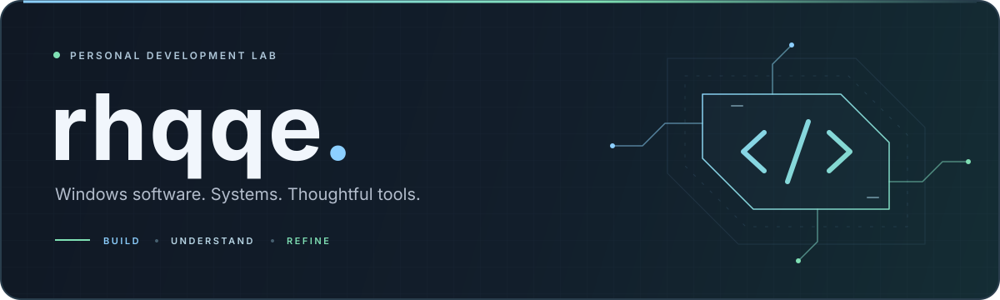

 

**I build desktop tools, explore systems, and care about the details.**

Clear interfaces. Reliable behavior. Repeatable builds.

  

     

 

## ✦ What I work on

| **◉ Desktop software** | **⌘ Systems & devices** | **↗ Developer tooling** |
| :--- | :--- | :--- |
| Native Windows applications with clean, deliberate interfaces. | Understanding how software works and how it connects to hardware. | Scripts, tests, and build automation that make development smoother. |

## ◈ How I like to build

- **Keep it clear.** Organize code by responsibility and make the next change easier.
- **Check the behavior.** Use focused tests and investigate what actually happens.
- **Make it repeatable.** Turn the useful steps into tools and documented workflows.
- **Polish the details.** Give the interface and the implementation the same attention.

 

